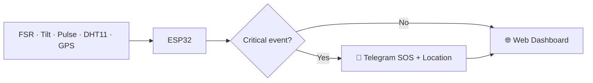
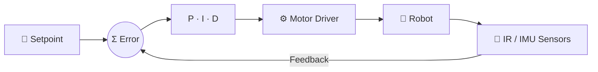

<!-- ============================ HERO ============================ -->
<div align="center">


<br/><br/>

<a href="https://github.com/thavanesh-d"></a>
<a href="https://www.linkedin.com/in/thavanesh-d-394723358/"></a>


<br/><br/>

<a href="#-about">ABOUT</a> &nbsp;|&nbsp;
<a href="#-tech-arsenal">TECH</a> &nbsp;|&nbsp;
<a href="#-featured-projects">PROJECTS</a> &nbsp;|&nbsp;
<a href="#-control-systems">CONTROL</a> &nbsp;|&nbsp;
<a href="#-roadmap">ROADMAP</a> &nbsp;|&nbsp;
<a href="#-contact">CONTACT</a>

</div>


<!-- ============================ ABOUT ============================ -->
## 👨‍💻 About

<table>
<tr>
<td width="22%" align="center" valign="middle">


**Thavanesh D.**
<br/>ECE Undergraduate
<br/>K.S. Rangasamy College of Technology

</td>
<td width="78%" valign="top">

I design **embedded systems that sense, decide and act**: from reading a sensor to tuning a control loop to pushing live data to the cloud.

- 🔌 Firmware in **C / Embedded C / C++** on **ESP32** and Arduino
- 🎛️ **PID-controlled robotics**: a prize-winning line follower and a self-balancing robot
- 📡 **IoT systems** with Wi-Fi dashboards, Blynk and Telegram alerts
- 🔧 Learning **PCB design** (KiCad / Altium) and **VLSI**
- 🧠 Exploring **TinyML / Edge AI** with Edge Impulse

</td>
</tr>
</table>

<div align="center">

| 🏆 **1** | ⚙️ **12+** | 🎛️ **3** | 🎯 **2026** |
|:--:|:--:|:--:|:--:|
| First Prize<br/>Evitron 2k26 | Hardware<br/>Projects Built | PID-based<br/>Robots | Focus: ESP32,<br/>RTOS, PCB |

</div>

<!-- ============================ TECH ============================ -->
## 🛠️ Tech Arsenal

<div align="center">


<br/><br/>

| Domain | Stack |
|:--|:--|
| 🔌 **Embedded & IoT** |     |
| 🎛️ **Control & Robotics** |     |
| 🔧 **Hardware & Protocols** |      |
| 🤖 **AI / TinyML** |   |
| 🧰 **Toolchain** |    |

</div>

<!-- ============================ PROJECTS ============================ -->
## 🚀 Featured Projects

<!-- ---------- PETTA ---------- -->


<table>
<tr>
<td width="65%" valign="top">

An autonomous, high-speed line follower. An **IR sensor array** reads the track and a **PID controller** converts position error into differential motor speeds for smooth cornering.

- 🎛️ Full **Kp / Ki / Kd** control loop on **ESP32**
- 📶 **Live PID tuning over Wi-Fi** through an ESP32-hosted web page, with no re-flashing between runs
- 🏆 **First Prize, Evitron 2k26** (Mahendra Engineering College), built as a two-member team

</td>
<td width="35%" valign="top">

**Stack**
`ESP32` `IR Array` `PID` `Motor Driver` `DC Motors` `Web Server` `Embedded C/C++`

</td>
</tr>
</table>

<!-- ---------- BALANCING ---------- -->


<table>
<tr>
<td width="65%" valign="top">

A two-wheeled robot that stays upright by actively fighting gravity. An **IMU** measures tilt, **sensor fusion** (accelerometer + gyroscope) gives a stable angle estimate, and a **PID controller** drives the motors to cancel the tilt in real time.

- 📐 Accelerometer + gyroscope angle estimation
- 🎚️ Kp / Ki / Kd tuned to balance response speed against oscillation and drift
- 🔁 Fast closed-loop control cycle for stable balance

</td>
<td width="35%" valign="top">

**Stack**
`ESP32 / Arduino` `IMU` `Sensor Fusion` `PID` `Motor Driver` `Gear Motors`

</td>
</tr>
</table>

<!-- ---------- AEROSHIELD ---------- -->


<table>
<tr>
<td width="65%" valign="top">

An ESP32 smart helmet for **real-time safety monitoring**. It tracks impact, tilt/fall, temperature, heart rate and GPS. On a critical event it sends an **SOS alert with the reason and live location** via **Telegram**, while a web dashboard shows live telemetry.



</td>
<td width="35%" valign="top">

**Stack**
`ESP32` `FSR` `Tilt Switch` `Pulse Sensor` `DHT11` `NEO-6M GPS` `Telegram` `Wi-Fi`

</td>
</tr>
</table>

<!-- ---------- PLANT ---------- -->


<table>
<tr>
<td width="65%" valign="top">

An IoT plant-care system with **automatic irrigation**. It monitors soil moisture, light, temperature and humidity, then controls the pump and LED on its own, with remote monitoring through **Blynk IoT**.

</td>
<td width="35%" valign="top">

**Stack**
`ESP32` `Blynk` `Soil Moisture` `LDR` `DHT11` `Relay` `Pump`

</td>
</tr>
</table>

### 🧩 More Builds

<div align="center">

| Project | What it does | Stack |
|:--|:--|:--|
| 🥄 **Hand Tremor Stabilization Spoon** | Assistive spoon that uses PID control to counter hand tremor | IMU • 2-axis Servos • ESP32 / Arduino Nano |
| ♻️ **Smart Bin (BinCredible)** *(in progress)* | AI-based waste segregation | ESP32 • Edge Impulse • Servos |
| 🏠 **Smart Hostel Room Monitor** | Environment monitoring and automation | ESP32 • BH1750 • SHT31 • DS3231 • PIR • OLED |
| 🧪 **Smart Lab Safety Monitor** | Gas, flame, light and climate safety | ESP32 • MQ135 • Flame • BH1750 • SHT31 |
| ☀️ **Solar Tracker** | Tracks the sun for maximum exposure | Servo • LDR |
| 🔐 **Laser Anti-Theft System** | Laser-tripwire intrusion detection | ESP32 • KY-800 • LDR |

</div>

<!-- ============================ CONTROL ============================ -->
## 🎛️ Control Systems

> **Measure → compute error → correct → repeat.** This loop sits at the core of my robots.



```cpp
// Core PID loop used across my robotics projects
float computePID(float setpoint, float measured) {
  float error = setpoint - measured;

  integral  += error * dt;                 // I: accumulated error
  float deriv = (error - prevError) / dt;  // D: rate of change
  prevError  = error;

  return Kp * error + Ki * integral + Kd * deriv;
}
```

<div align="center">

| Term | Role | Effect when tuned right |
|:--:|:--|:--|
| **P** | Reacts to present error | Fast response |
| **I** | Removes accumulated error | No steady-state drift |
| **D** | Predicts the trend | Less overshoot, smoother motion |

</div>

<!-- ============================ ROADMAP ============================ -->
## 🗺️ Roadmap


<table>
<tr>
<td width="50%" valign="top">

### 🎯 2026
- [ ] Master Embedded C and ESP32
- [ ] Advanced PCB design
- [ ] RTOS fundamentals
- [ ] Improve C++, Python and DSA
- [ ] Ship more IoT and robotics projects

</td>
<td width="50%" valign="top">

### 🚀 2027+
- [ ] Advanced embedded systems
- [ ] VLSI design
- [ ] TinyML / Edge AI
- [ ] Advanced robotics
- [ ] Open-source contributions

</td>
</tr>
</table>

<!-- ============================ ANALYTICS ============================ -->
## 📊 GitHub Analytics

<div align="center">


<br/>


<br/>


<br/>


</div>

<!-- ============================ PHILOSOPHY ============================ -->
<div align="center">

## 💡 Engineering Philosophy

### `Learn → Build → Break → Debug → Improve → Repeat`

*The best way to learn electronics is to build real hardware, watch it fail, and understand exactly why.*

</div>

<!-- ============================ CONTACT ============================ -->
## 🤝 Contact

<div align="center">

Open to **internships, collaborations and embedded / IoT / robotics projects.**

<a href="https://www.linkedin.com/in/thavanesh-d-394723358/"></a>
<a href="https://github.com/thavanesh-d"></a>

**⚡ Electronics • Code • Innovation ⚡**


</div>
