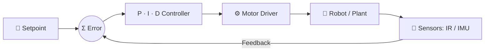
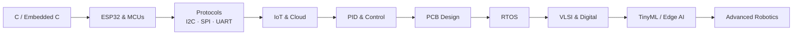

<!-- ===================== HEADER ===================== -->
<div align="center">


<a href="https://github.com/thavanesh-d">
  
</a>

<br/>

<a href="https://github.com/thavanesh-d"></a>
<a href="https://www.linkedin.com/in/thavanesh-d-394723358/"></a>


<br/><br/>

<a href="#-featured-projects">🚀 Projects</a> &nbsp;•&nbsp;
<a href="#-tech-arsenal">🛠️ Tech Arsenal</a> &nbsp;•&nbsp;
<a href="#-control-systems-in-action">🎛️ Control Systems</a> &nbsp;•&nbsp;
<a href="#-roadmap">🗺️ Roadmap</a> &nbsp;•&nbsp;
<a href="#-lets-connect">🤝 Connect</a>

</div>

---

## 👨‍💻 About Me

> **ECE undergraduate at K.S. Rangasamy College of Technology**, focused on turning ideas into working hardware, from sensor to firmware to cloud.

<table>
<tr>
<td width="50%" valign="top">

### 🔭 What I Do
- 🔌 Design embedded firmware in **C / Embedded C / C++**
- 📡 Build **IoT systems** on ESP32 with Wi-Fi dashboards, Telegram alerts and cloud platforms
- 🎛️ Implement **PID control** for line following and self-balancing robots
- 🔧 Learning **PCB design** (KiCad, Altium)
- 🧠 Exploring **TinyML / Edge AI** with Edge Impulse

</td>
<td width="50%" valign="top">

### 🎯 Current Focus
- ⚡ **ESP32** and advanced embedded systems
- 🔁 **RTOS** fundamentals
- 🧩 Communication protocols: **I2C • SPI • UART**
- 🖥️ **VLSI** and digital electronics
- 🧮 **DSA** and **C++** for stronger fundamentals

</td>
</tr>
</table>

---

## 🛠️ Tech Arsenal

<div align="center">

| Domain | Stack |
|:--|:--|
| 💻 **Languages** |     |
| 🔌 **Embedded & IoT** |      |
| 🎛️ **Control & Robotics** |     |
| 🔧 **Hardware** |      |
| 🤖 **AI / TinyML** |    |
| 🌐 **Tools** |      |

</div>

---

## 🚀 Featured Projects

### 🏁 Petta 2.0 Reloaded: PID Line Following Robot &nbsp;🏆 *First Prize, Evitron 2k26*

<table>
<tr>
<td width="62%" valign="top">

An autonomous, high-speed line follower. An **IR sensor array** reads the track, and a **PID controller** converts the position error into differential motor speeds for smooth cornering at speed.

**Highlights**
- 🎛️ Full **PID loop** (Kp, Ki, Kd) running on **ESP32**
- 📶 **Live tuning over Wi-Fi** from an ESP32-hosted web page, with no re-flashing or re-plugging between runs
- 🏆 **First Prize at Evitron 2k26** (Mahendra Engineering College), built as a two-member team

</td>
<td width="38%" valign="top">

**Tech**
`ESP32` `IR Sensor Array` `PID Control` `Motor Driver` `DC Motors` `Web Server` `Embedded C/C++`

</td>
</tr>
</table>

---

### ⚖️ Self-Balancing Robot: PID Inverted Pendulum

<table>
<tr>
<td width="62%" valign="top">

A two-wheeled robot that stays upright by actively fighting gravity. An **IMU** measures tilt, **sensor fusion** (accelerometer + gyroscope) produces a stable angle estimate, and a **PID controller** drives the motors to cancel the tilt in real time.

**Highlights**
- 📐 Angle estimation through accelerometer–gyroscope fusion
- 🎚️ Tuned Kp / Ki / Kd to balance response speed against oscillation and drift
- 🔁 Fast closed-loop control cycle for stable balance

</td>
<td width="38%" valign="top">

**Tech**
`ESP32 / Arduino` `IMU` `Sensor Fusion` `PID Control` `Motor Driver` `DC Gear Motors`

</td>
</tr>
</table>

---

### 🚨 AeroShield: Smart Safety Helmet

<table>
<tr>
<td width="62%" valign="top">

An ESP32-based smart helmet for **emergency detection and real-time safety monitoring**. It tracks impact force, tilt/fall, temperature, heart rate and GPS position. On a critical event it builds an **SOS alert with the reason and live location** and sends it through **Telegram**, while a web dashboard shows live telemetry.

</td>
<td width="38%" valign="top">

**Tech**
`ESP32` `FSR` `Tilt Switch` `Pulse Sensor` `DHT11` `NEO-6M GPS` `Telegram` `Wi-Fi Dashboard`

</td>
</tr>
</table>

---

### 🌱 ESP32 Smart Plant System

<table>
<tr>
<td width="62%" valign="top">

An IoT plant-care system with **automatic irrigation**. It monitors soil moisture, light, temperature and humidity, then controls the water pump and LED on its own. Live data and device status are available remotely through **Blynk IoT**.

</td>
<td width="38%" valign="top">

**Tech**
`ESP32` `Blynk IoT` `Soil Moisture` `LDR` `DHT11` `Relay` `Water Pump`

</td>
</tr>
</table>

### 🧩 More Builds

| Project | What it does | Stack |
|:--|:--|:--|
| 🥄 **Hand Tremor Stabilization Spoon** | Assistive self-stabilizing spoon for tremor, using PID control to counter hand movement | Accelerometer + Gyroscope • 2-axis Servos • ESP32/Arduino Nano |
| ♻️ **Smart Bin (BinCredible)** *(in progress)* | Waste segregation with AI image classification | ESP32 • Edge Impulse • Servos |
| 🏠 **Smart Hostel Room Monitor** | Environmental monitoring and automation | ESP32 • BH1750 • SHT31 • DS3231 • PIR • OLED |
| 🧪 **Smart Laboratory Safety Monitor** | Gas, flame, light and climate safety monitoring | ESP32 • MQ135 • Flame Sensor • BH1750 • SHT31 |
| ☀️ **Solar Tracker** | Tracks the sun to maximise panel exposure | Servo • LDR |
| 🔐 **Laser Anti-Theft System** | Laser-tripwire intrusion detection | ESP32 • KY-800 Laser • LDR |

---

## 🎛️ Control Systems in Action

My robots run on one core idea: **measure → compute error → correct → repeat**.



```cpp
// Core PID loop used across my robotics projects
float computePID(float setpoint, float measured) {
  float error = setpoint - measured;

  integral  += error * dt;                 // I: accumulated error
  float deriv = (error - prevError) / dt;  // D: rate of change
  prevError  = error;

  return Kp * error + Ki * integral + Kd * deriv;
}
```

| Term | Role | Effect when tuned right |
|:--:|:--|:--|
| **P** | Reacts to the present error | Fast response |
| **I** | Removes accumulated error | No steady-state drift |
| **D** | Predicts the trend | Less overshoot, smoother motion |

---

## 🗺️ Roadmap



<table>
<tr>
<td width="50%" valign="top">

### 🎯 2026
- [ ] Master Embedded C and ESP32
- [ ] Advanced PCB design
- [ ] RTOS fundamentals
- [ ] Improve C++, Python and DSA
- [ ] Ship more IoT and robotics projects
- [ ] Build strong GitHub repositories

</td>
<td width="50%" valign="top">

### 🚀 2027+
- [ ] Advanced embedded systems
- [ ] VLSI design
- [ ] TinyML / Edge AI
- [ ] Advanced robotics
- [ ] Open-source contributions
- [ ] Industry-level IoT systems

</td>
</tr>
</table>

---

## 📊 GitHub Analytics

<div align="center">


<br/>


<br/>


</div>

---

## 💡 Engineering Philosophy

<div align="center">

### `Learn → Build → Break → Debug → Improve → Repeat`

*The best way to learn electronics is to build real hardware, watch it fail, and understand exactly why.*

</div>

---

## 🤝 Let's Connect

<div align="center">

I'm open to **internships, collaborations and embedded / IoT / robotics projects**.

<a href="https://www.linkedin.com/in/thavanesh-d-394723358/"></a>
<a href="https://github.com/thavanesh-d"></a>

⭐ *If you like my projects, consider leaving a star!*

<br/>

**⚡ Electronics • Code • Innovation ⚡**


</div>
