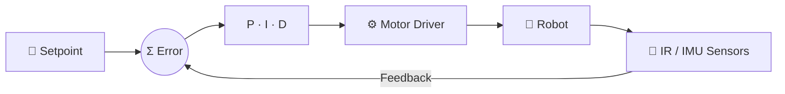
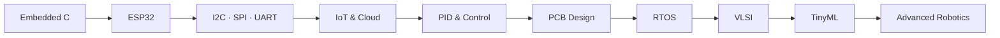

"""
ALL-IN-ONE profile installer.
Run this ONE file inside your profile repo folder (e.g. thavanesh-d/thavanesh-d):

    python setup_profile.py

It creates README.md, assets/*.svg (16 animated 3D graphics) and
.github/workflows/profile-3d.yml. Then commit and push.
"""
README = r'''<div align="center">


<br/><br/>

<a href="https://github.com/thavanesh-d"></a>
<a href="https://www.linkedin.com/in/thavanesh-d-394723358/"></a>


</div>

<br/>


<table>
<tr>
<td width="40%" align="center" valign="middle">


</td>
<td width="60%" valign="top">


**Thavanesh D.** | ECE Undergraduate
<br/>K.S. Rangasamy College of Technology

I design **embedded systems that sense, decide and act**: from reading a sensor, to tuning a control loop, to pushing live data to the cloud.

- 🔌 Firmware in **C / Embedded C / C++** on **ESP32** and Arduino
- 🎛️ **PID-controlled robotics**: a prize-winning line follower and a self-balancing robot
- 📡 **IoT systems** with Wi-Fi dashboards, Blynk and Telegram alerts
- 🔧 Learning **PCB design** (KiCad / Altium) and **VLSI**
- 🧠 Exploring **TinyML / Edge AI** with Edge Impulse

</td>
</tr>
</table>


<div align="center">


<br/><br/>

| Domain | Stack |
|:--|:--|
| 🔌 **Embedded & IoT** |     |
| 🎛️ **Control & Robotics** |     |
| 🔧 **Hardware & Protocols** |      |
| 🤖 **AI / TinyML** |   |
| 🧰 **Toolchain** |    |

</div>


<table>
<tr>
<td width="50%" valign="middle">


</td>
<td width="50%" valign="top">

An autonomous, high-speed line follower. An **IR sensor array** reads the track and a **PID controller** turns position error into differential motor speeds for smooth cornering.

- 🎛️ Full **Kp / Ki / Kd** loop on **ESP32**
- 📶 **Live PID tuning over Wi-Fi** from an ESP32-hosted web page, with no re-flashing between runs
- 🏆 **First Prize, Evitron 2k26** (Mahendra Engineering College), built as a two-member team

</td>
</tr>
</table>


<table>
<tr>
<td width="50%" valign="top">

A two-wheeled robot that stays upright by actively fighting gravity. An **IMU** measures tilt, **sensor fusion** (accelerometer + gyroscope) gives a stable angle estimate, and a **PID controller** drives the motors to cancel the tilt in real time.

- 📐 Accelerometer + gyroscope angle estimation
- 🎚️ Kp / Ki / Kd tuned to balance response speed against oscillation and drift
- 🔁 Fast closed-loop cycle for stable balance

</td>
<td width="50%" valign="middle">


</td>
</tr>
</table>


An ESP32 smart helmet for **real-time safety monitoring**. It tracks impact, tilt/fall, temperature, heart rate and GPS. On a critical event it sends an **SOS alert with the reason and live location** through **Telegram**, while a web dashboard shows live telemetry.


An IoT plant-care system with **automatic irrigation**. It monitors soil moisture, light, temperature and humidity, then controls the pump and LED on its own, with remote monitoring through **Blynk IoT**.

### 🧩 More Builds

<div align="center">

| Project | What it does | Stack |
|:--|:--|:--|
| 🥄 **Hand Tremor Stabilization Spoon** | Assistive spoon that uses PID control to counter hand tremor | IMU • 2-axis Servos • ESP32 / Arduino Nano |
| ♻️ **Smart Bin (BinCredible)** *(in progress)* | AI-based waste segregation | ESP32 • Edge Impulse • Servos |
| 🏠 **Smart Hostel Room Monitor** | Environment monitoring and automation | ESP32 • BH1750 • SHT31 • DS3231 • PIR • OLED |
| 🧪 **Smart Lab Safety Monitor** | Gas, flame, light and climate safety | ESP32 • MQ135 • Flame • BH1750 • SHT31 |
| ☀️ **Solar Tracker** | Tracks the sun for maximum exposure | Servo • LDR |
| 🔐 **Laser Anti-Theft System** | Laser-tripwire intrusion detection | ESP32 • KY-800 • LDR |

</div>


> **Measure → compute error → correct → repeat.** This loop sits at the core of my robots.



```cpp
// Core PID loop used across my robotics projects
float computePID(float setpoint, float measured) {
  float error = setpoint - measured;

  integral  += error * dt;                 // I: accumulated error
  float deriv = (error - prevError) / dt;  // D: rate of change
  prevError  = error;

  return Kp * error + Ki * integral + Kd * deriv;
}
```

<div align="center">

| Term | Role | Effect when tuned right |
|:--:|:--|:--|
| **P** | Reacts to present error | Fast response |
| **I** | Removes accumulated error | No steady-state drift |
| **D** | Predicts the trend | Less overshoot, smoother motion |

</div>


<div align="center">


</div>


<div align="center">


<br/>


<br/>


</div>




<table>
<tr>
<td width="50%" valign="top">

### 🎯 2026
- [ ] Master Embedded C and ESP32
- [ ] Advanced PCB design
- [ ] RTOS fundamentals
- [ ] Improve C++, Python and DSA
- [ ] Ship more IoT and robotics projects

</td>
<td width="50%" valign="top">

### 🚀 2027+
- [ ] Advanced embedded systems
- [ ] VLSI design
- [ ] TinyML / Edge AI
- [ ] Advanced robotics
- [ ] Open-source contributions

</td>
</tr>
</table>

<div align="center">

### `Learn → Build → Break → Debug → Improve → Repeat`

*The best way to learn electronics is to build real hardware, watch it fail, and understand exactly why.*

</div>


<div align="center">

Open to **internships, collaborations and embedded / IoT / robotics projects.**

<a href="https://www.linkedin.com/in/thavanesh-d-394723358/"></a>
<a href="https://github.com/thavanesh-d"></a>

**⚡ Electronics • Code • Innovation ⚡**


</div>
'''

WORKFLOW = r'''name: Profile 3D and Snake

on:
  schedule:
    - cron: "0 18 * * *"
  workflow_dispatch:

permissions:
  contents: write

jobs:
  generate:
    runs-on: ubuntu-latest
    steps:
      - uses: actions/checkout@v4

      - name: Generate 3D contribution graph
        uses: yoshi389111/github-profile-3d-contrib@0.7.1
        env:
          GITHUB_TOKEN: ${{ secrets.GITHUB_TOKEN }}
          USERNAME: ${{ github.repository_owner }}

      - name: Generate snake animation
        uses: Platane/snk/svg-only@v3
        with:
          github_user_name: ${{ github.repository_owner }}
          outputs: |
            dist/github-snake-dark.svg?palette=github-dark

      - name: Commit generated files
        run: |
          mkdir -p assets && cp dist/github-snake-dark.svg assets/snake.svg
          git config user.name "github-actions"
          git config user.email "github-actions@github.com"
          git add profile-3d-contrib assets/snake.svg
          git commit -m "chore: update 3D graph and snake" || exit 0
          git push
'''

# ---- SVG generator ----
import os, math, random
from xml.sax.saxutils import escape

OUT = os.getcwd()
A = OUT + "/assets"
os.makedirs(A, exist_ok=True)
FONT = "font-family=\"'Segoe UI','Helvetica Neue',Arial,sans-serif\""
SPL = 'calcMode="spline" keyTimes="0;0.5;1" keySplines=".45 0 .55 1;.45 0 .55 1"'

def save(name, svg):
    with open(f"{A}/{name}", "w", encoding="utf-8") as f:
        f.write(svg)

def mix(c1, c2, t):
    a = [int(c1[i:i+2], 16) for i in (1, 3, 5)]
    b = [int(c2[i:i+2], 16) for i in (1, 3, 5)]
    return "#%02x%02x%02x" % tuple(int(a[i] + (b[i]-a[i])*t) for i in range(3))

def iso_box(fx, fy, sx, sy, h, top, left, right, extra=""):
    """front-bottom corner F=(fx,fy). b=(.866,.5) spans left face, -a=(.866,-.5) spans right face."""
    bx, by = 0.866, 0.5
    L = (fx - bx*sx, fy - by*sx)
    F = (fx, fy)
    R = (fx + bx*sy, fy - by*sy)
    B = (L[0] + bx*sy, L[1] - by*sy)
    def p(pt, dy=0): return f"{pt[0]:.1f},{pt[1]-dy:.1f}"
    s = f'<polygon points="{p(L)} {p(F)} {p(F,h)} {p(L,h)}" fill="{left}" {extra}/>'
    s += f'<polygon points="{p(F)} {p(R)} {p(R,h)} {p(F,h)}" fill="{right}" {extra}/>'
    s += f'<polygon points="{p(L,h)} {p(F,h)} {p(R,h)} {p(B,h)}" fill="{top}" {extra}/>'
    return s, dict(L=L, F=F, R=R, B=B)

def glow_defs():
    return ('<filter id="glow" x="-50%" y="-50%" width="200%" height="200%"><feGaussianBlur stdDeviation="3" result="b"/>'
            '<feMerge><feMergeNode in="b"/><feMergeNode in="SourceGraphic"/></feMerge></filter>')

# ------------------------------------------------------------------ HERO
def hero():
    W, H = 1000, 340
    hz = 218
    s = f'<svg xmlns="http://www.w3.org/2000/svg" viewBox="0 0 {W} {H}" width="{W}" height="{H}">'
    s += '<defs>'
    s += '<linearGradient id="bg" x1="0" y1="0" x2="0" y2="1"><stop offset="0" stop-color="#04060c"/><stop offset="1" stop-color="#0c1630"/></linearGradient>'
    s += '<linearGradient id="face" x1="0" y1="0" x2="1" y2="0"><stop offset="0" stop-color="#ffffff"/><stop offset=".5" stop-color="#9ff3ff"/><stop offset="1" stop-color="#6ea8ff"/></linearGradient>'
    s += f'<radialGradient id="hz" cx="50%" cy="{hz/H*100:.0f}%" r="45%"><stop offset="0" stop-color="#00e5ff" stop-opacity=".35"/><stop offset="1" stop-color="#00e5ff" stop-opacity="0"/></radialGradient>'
    s += f'<clipPath id="floor"><rect x="0" y="{hz}" width="{W}" height="{H-hz}"/></clipPath>'
    s += glow_defs() + '</defs>'
    s += f'<rect width="{W}" height="{H}" fill="url(#bg)"/>'
    s += f'<rect width="{W}" height="{H}" fill="url(#hz)"/>'
    random.seed(7)
    for _ in range(45):
        x, y, r = random.randint(8, 992), random.randint(8, hz-20), random.choice([0.8, 1.1, 1.5])
        d = random.uniform(2, 5)
        s += f'<circle cx="{x}" cy="{y}" r="{r}" fill="#cfefff"><animate attributeName="opacity" values="0.15;1;0.15" dur="{d:.1f}s" repeatCount="indefinite"/></circle>'
    # perspective floor
    s += '<g clip-path="url(#floor)" stroke="#00e5ff" fill="none">'
    for k in range(-12, 13):
        s += f'<line x1="500" y1="{hz}" x2="{500+k*150}" y2="{H+60}" stroke-width="1" stroke-opacity="0.35"/>'
    N = 9
    f = lambda t: hz + 140*(t**2.1)
    for i in range(N):
        y0, y1 = f(i/N), f((i+1)/N)
        o0, o1 = 0.1+0.7*(i/N), 0.1+0.7*((i+1)/N)
        s += (f'<line x1="0" x2="{W}" y1="{y0:.1f}" y2="{y0:.1f}" stroke-width="1.2" stroke-opacity="{o0:.2f}">'
              f'<animate attributeName="y1" values="{y0:.1f};{y1:.1f}" dur="2.4s" repeatCount="indefinite"/>'
              f'<animate attributeName="y2" values="{y0:.1f};{y1:.1f}" dur="2.4s" repeatCount="indefinite"/>'
              f'<animate attributeName="stroke-opacity" values="{o0:.2f};{o1:.2f}" dur="2.4s" repeatCount="indefinite"/></line>')
    s += '</g>'
    s += f'<line x1="0" x2="{W}" y1="{hz}" y2="{hz}" stroke="#00e5ff" stroke-width="1.5" stroke-opacity=".8" filter="url(#glow)"/>'
    # floating cubes
    def cube(cx, cy, sz, dur, ph):
        a, _ = iso_box(cx, cy, sz, sz, sz, "#7ff3ff", "#1a8cc9", "#0b4f8a")
        return (f'<g><animateTransform attributeName="transform" type="translate" values="0 0;0 -14;0 0" dur="{dur}s" begin="{ph}s" repeatCount="indefinite" {SPL}/>'
                f'<g filter="url(#glow)">{a}</g></g>')
    s += cube(60, 78, 26, 4.5, 0) + cube(940, 74, 22, 5.5, 1.2) + cube(140, 44, 12, 3.8, .6) + cube(860, 40, 13, 4.2, 2)
    # extruded 3D title
    title = "THAVANESH DHANABALAN"
    s += '<g>'
    s += f'<animateTransform attributeName="transform" type="translate" values="0 0;0 -5;0 0" dur="5s" repeatCount="indefinite" {SPL}/>'
    for i in range(16, 0, -1):
        col = mix("#0a6b8a", "#031a24", i/16)
        s += f'<text x="{50+i*0.85:.1f}" y="{158+i*0.85:.1f}" {FONT} font-size="62" font-weight="900" textLength="900" lengthAdjust="spacingAndGlyphs" fill="{col}">{title}</text>'
    s += f'<text x="50" y="158" {FONT} font-size="62" font-weight="900" textLength="900" lengthAdjust="spacingAndGlyphs" fill="url(#face)" stroke="#ffffff" stroke-opacity=".35" stroke-width="1">{title}</text>'
    s += '</g>'
    s += (f'<text x="500" y="200" text-anchor="middle" {FONT} font-size="19" font-weight="700" letter-spacing="6" fill="#7fe9ff" filter="url(#glow)">'
          'EMBEDDED SYSTEMS  •  IoT  •  ROBOTICS  •  VLSI</text>')
    s += '</svg>'
    save("hero.svg", s)

# ------------------------------------------------------------------ SECTION HEADERS
def section(name, title, c1="#9ff3ff", c2="#6ea8ff"):
    W, H = 1000, 84
    s = f'<svg xmlns="http://www.w3.org/2000/svg" viewBox="0 0 {W} {H}" width="{W}" height="{H}">'
    s += f'<defs><linearGradient id="g" x1="0" y1="0" x2="1" y2="0"><stop offset="0" stop-color="#fff"/><stop offset="1" stop-color="{c1}"/></linearGradient>'
    s += f'<linearGradient id="ln" x1="0" y1="0" x2="1" y2="0"><stop offset="0" stop-color="{c1}"/><stop offset="1" stop-color="{c2}" stop-opacity="0"/></linearGradient>{glow_defs()}</defs>'
    cube, _ = iso_box(44, 58, 22, 22, 22, c1, mix(c1, "#000000", .45), mix(c1, "#000000", .7))
    s += f'<g filter="url(#glow)"><animateTransform attributeName="transform" type="translate" values="0 0;0 -4;0 0" dur="3.6s" repeatCount="indefinite" {SPL}/>{cube}</g>'
    for i in range(10, 0, -1):
        s += f'<text x="{88+i*0.7:.1f}" y="{56+i*0.7:.1f}" {FONT} font-size="42" font-weight="900" letter-spacing="3" fill="{mix(mix(c1,"#000000",.4), "#02050a", i/10)}">{escape(title)}</text>'
    s += f'<text x="88" y="56" {FONT} font-size="42" font-weight="900" letter-spacing="3" fill="url(#g)">{escape(title)}</text>'
    s += '<line x1="30" y1="76" x2="970" y2="76" stroke="url(#ln)" stroke-width="2"/>'
    s += f'<circle r="4" cy="76" fill="{c1}" filter="url(#glow)"><animate attributeName="cx" values="30;970" dur="3.5s" repeatCount="indefinite"/></circle>'
    s += '</svg>'
    save(name, s)

# ------------------------------------------------------------------ PROJECT CARDS
def card(name, title, sub, chips, c1, c2):
    W, H = 1000, 176
    s = f'<svg xmlns="http://www.w3.org/2000/svg" viewBox="0 0 {W} {H}" width="{W}" height="{H}">'
    s += (f'<defs><linearGradient id="ed" x1="0" y1="0" x2="1" y2="0"><stop offset="0" stop-color="{c1}"/><stop offset="1" stop-color="{c2}"/></linearGradient>'
          '<linearGradient id="sh" x1="0" y1="0" x2="1" y2="0"><stop offset="0" stop-color="#fff" stop-opacity="0"/><stop offset=".5" stop-color="#fff" stop-opacity=".16"/><stop offset="1" stop-color="#fff" stop-opacity="0"/></linearGradient>'
          '<clipPath id="cp"><rect x="0" y="20" width="860" height="124" rx="12"/></clipPath>'
          f'{glow_defs()}</defs>')
    s += '<g transform="translate(70,0) skewX(-8)">'
    for i in range(14, 0, -1):
        s += f'<rect x="{i*1.1:.1f}" y="{20+i*1.1:.1f}" width="860" height="124" rx="12" fill="{mix(mix(c1,"#000000",.55), "#03060c", i/14)}"/>'
    s += '<rect x="0" y="20" width="860" height="124" rx="12" fill="#0b1222" stroke="url(#ed)" stroke-width="2.5"/>'
    s += '<rect x="0" y="20" width="12" height="124" rx="6" fill="url(#ed)"/>'
    s += '<g clip-path="url(#cp)"><rect y="20" width="200" height="124" fill="url(#sh)"><animate attributeName="x" values="-220;880" dur="4s" repeatCount="indefinite"/></rect></g>'
    for i in range(5, 0, -1):
        s += f'<text x="{34+i*0.8:.1f}" y="{74+i*0.8:.1f}" {FONT} font-size="38" font-weight="900" fill="{mix(mix(c1,"#000000",.5), "#02050a", i/5)}">{escape(title)}</text>'
    s += f'<text x="34" y="74" {FONT} font-size="38" font-weight="900" fill="#ffffff">{escape(title)}</text>'
    s += f'<text x="36" y="102" {FONT} font-size="16" font-weight="600" fill="{c1}">{escape(sub)}</text>'
    x = 36
    for c in chips:
        w = 9*len(c)+22
        s += f'<rect x="{x}" y="114" width="{w}" height="22" rx="11" fill="none" stroke="{c1}" stroke-opacity=".7"/>'
        s += f'<text x="{x+w/2}" y="129" text-anchor="middle" {FONT} font-size="12" font-weight="700" fill="#cfe9ff">{escape(c)}</text>'
        x += w + 8
    s += '</g></svg>'
    save(name, s)

# ------------------------------------------------------------------ ISO CHIP (ESP32)
def chip():
    W, H = 600, 430
    cx, cy = 300, 215
    s = f'<svg xmlns="http://www.w3.org/2000/svg" viewBox="0 0 {W} {H}" width="{W}" height="{H}"><rect width="{W}" height="{H}" rx="18" fill="#070b14"/>'
    s += (f'<defs><linearGradient id="pcb" x1="0" y1="0" x2="1" y2="1"><stop offset="0" stop-color="#0f5a43"/><stop offset="1" stop-color="#083a2c"/></linearGradient>'
          '<linearGradient id="top" x1="0" y1="0" x2="1" y2="1"><stop offset="0" stop-color="#2a3550"/><stop offset="1" stop-color="#121a2c"/></linearGradient>'
          f'{glow_defs()}</defs>')
    # pcb slab
    sp = 130
    Lx, Rx, Ty, By = cx - 0.866*2*sp/1, cx + 0.866*2*sp, cy - 0.5*2*sp*0 - sp*0.5*2*0, 0
    # rhombus extents for square half-size sp: X=±1.732*sp ... use matrix mapping
    X, Y = 0.866*2*sp, 0.5*2*sp  # half-width, half-height of rhombus
    t = 16
    s += f'<polygon points="{cx-X:.1f},{cy:.1f} {cx:.1f},{cy+Y:.1f} {cx:.1f},{cy+Y+t:.1f} {cx-X:.1f},{cy+t:.1f}" fill="#062b20"/>'
    s += f'<polygon points="{cx:.1f},{cy+Y:.1f} {cx+X:.1f},{cy:.1f} {cx+X:.1f},{cy+t:.1f} {cx:.1f},{cy+Y+t:.1f}" fill="#041d16"/>'
    s += f'<g transform="matrix(0.866,0.5,-0.866,0.5,{cx},{cy})">'
    s += f'<rect x="{-sp}" y="{-sp}" width="{2*sp}" height="{2*sp}" fill="url(#pcb)" stroke="#19c08e" stroke-opacity=".6" stroke-width="2"/>'
    for i in (-60, -30, 0, 30, 60):
        for sgn in (-1, 1):
            d = f"M{i} {sgn*72} V{sgn*98} H{i*1.9:.0f} V{sgn*sp}"
            s += f'<path d="{d}" stroke="#0a8a68" stroke-width="3" fill="none"/>'
            s += (f'<path d="{d}" stroke="#7ff3ff" stroke-width="3" fill="none" stroke-dasharray="8 52" filter="url(#glow)">'
                  f'<animate attributeName="stroke-dashoffset" values="{60 if sgn>0 else 0};{0 if sgn>0 else 60}" dur="{1.4+abs(i)/90:.2f}s" repeatCount="indefinite"/></path>')
        for sgn in (-1, 1):
            d = f"M{sgn*72} {i} H{sgn*98} V{i*1.9:.0f} H{sgn*sp}"
            s += f'<path d="{d}" stroke="#0a8a68" stroke-width="3" fill="none"/>'
            s += (f'<path d="{d}" stroke="#ffd166" stroke-width="3" fill="none" stroke-dasharray="8 52" filter="url(#glow)">'
                  f'<animate attributeName="stroke-dashoffset" values="{60 if sgn>0 else 0};{0 if sgn>0 else 60}" dur="{1.8+abs(i)/90:.2f}s" repeatCount="indefinite"/></path>')
    for (px, py) in [(-sp+14, -sp+14), (sp-14, -sp+14), (-sp+14, sp-14), (sp-14, sp-14)]:
        s += f'<circle cx="{px}" cy="{py}" r="6" fill="#031510" stroke="#19c08e"/>'
    s += '</g>'
    # chip (raised)
    cs, ch = 70, 26
    cyc = cy - 8
    CX, CY = 0.866*2*cs, 0.5*2*cs
    s += (f'<g><animateTransform attributeName="transform" type="translate" values="0 0;0 -9;0 0" dur="4s" repeatCount="indefinite" {SPL}/>')
    s += f'<polygon points="{cx-CX:.1f},{cyc:.1f} {cx:.1f},{cyc+CY:.1f} {cx:.1f},{cyc+CY+ch:.1f} {cx-CX:.1f},{cyc+ch:.1f}" fill="#0b1020"/>'
    s += f'<polygon points="{cx:.1f},{cyc+CY:.1f} {cx+CX:.1f},{cyc:.1f} {cx+CX:.1f},{cyc+ch:.1f} {cx:.1f},{cyc+CY+ch:.1f}" fill="#060a14"/>'
    s += f'<g transform="matrix(0.866,0.5,-0.866,0.5,{cx},{cyc})">'
    for i in range(-5, 6):
        for sgn in (-1, 1):
            s += f'<rect x="{i*12-3}" y="{sgn*cs + (-9 if sgn<0 else 0)}" width="6" height="9" fill="#d4af37"/>'
            s += f'<rect x="{sgn*cs + (-9 if sgn<0 else 0)}" y="{i*12-3}" width="9" height="6" fill="#d4af37"/>'
    s += f'<rect x="{-cs}" y="{-cs}" width="{2*cs}" height="{2*cs}" fill="url(#top)" stroke="#00e5ff" stroke-width="2" filter="url(#glow)"/>'
    s += '<circle cx="-48" cy="-48" r="5" fill="#00e5ff"><animate attributeName="opacity" values="1;.2;1" dur="1.2s" repeatCount="indefinite"/></circle>'
    s += f'<text x="0" y="8" text-anchor="middle" {FONT} font-size="30" font-weight="900" fill="#ffffff" letter-spacing="2">ESP32</text>'
    s += f'<text x="0" y="30" text-anchor="middle" {FONT} font-size="11" font-weight="700" fill="#7fe9ff" letter-spacing="2">WI-FI  +  BT</text>'
    s += '</g></g></svg>'
    save("chip-3d.svg", s)

# ------------------------------------------------------------------ SELF-BALANCING ROBOT
def balancer():
    W, H = 520, 400
    s = f'<svg xmlns="http://www.w3.org/2000/svg" viewBox="0 0 {W} {H}" width="{W}" height="{H}"><rect width="{W}" height="{H}" rx="18" fill="#070b14"/>'
    s += f'<defs><radialGradient id="fl" cx="50%" cy="50%" r="50%"><stop offset="0" stop-color="#00e5ff" stop-opacity=".25"/><stop offset="1" stop-color="#00e5ff" stop-opacity="0"/></radialGradient>{glow_defs()}</defs>'
    # floor
    s += '<ellipse cx="260" cy="316" rx="210" ry="62" fill="url(#fl)"/>'
    s += '<g stroke="#00e5ff" stroke-opacity=".25" fill="none">'
    for k in range(-6, 7):
        s += f'<line x1="{260+k*14}" y1="262" x2="{260+k*38}" y2="372"/>'
    for j in range(6):
        y = 262 + 110*(j/5)**1.8
        s += f'<line x1="{60-j*10}" y1="{y:.0f}" x2="{460+j*10}" y2="{y:.0f}"/>'
    s += '</g>'
    sx, sy = 96, 60
    def wheel(c, r=36):
        o = f'<g transform="matrix(0.866,0.5,0,-1,{c[0]:.1f},{c[1]:.1f})">'
        o += f'<circle r="{r}" fill="#0a0e18" stroke="#e8eefc" stroke-width="3"/><circle r="{r-9}" fill="#161d30" stroke="#00e5ff" stroke-width="2"/>'
        o += '<g stroke="#00e5ff" stroke-width="2">'
        for k in range(6):
            a = k*math.pi/3
            o += f'<line x1="0" y1="0" x2="{(r-10)*math.cos(a):.1f}" y2="{(r-10)*math.sin(a):.1f}"/>'
        o += '<animateTransform attributeName="transform" type="rotate" from="0" to="360" dur="1.1s" repeatCount="indefinite"/></g>'
        o += '<circle r="5" fill="#00e5ff"/></g>'
        return o
    s += '<g>'
    s += '<animateTransform attributeName="transform" type="rotate" values="-6 260 322;6 260 322;-6 260 322" dur="2.6s" repeatCount="indefinite" calcMode="spline" keyTimes="0;0.5;1" keySplines=".45 0 .55 1;.45 0 .55 1"/>'
    F = (260, 316)
    bx, by = 0.866, 0.5
    L = (F[0]-bx*sx, F[1]-by*sx); R = (F[0]+bx*sy, F[1]-by*sy); B = (L[0]+bx*sy, L[1]-by*sy)
    axle = 36
    midLF = ((L[0]+F[0])/2, (L[1]+F[1])/2 - axle)
    midRB = ((R[0]+B[0])/2, (R[1]+B[1])/2 - axle)
    a = (-0.866, 0.5)
    off = 14
    s += wheel((midRB[0]-a[0]*off, midRB[1]-a[1]*off))
    # layers
    y1 = F[1]-axle
    p1, g1 = iso_box(F[0], y1, sx, sy, 8, "#2b3a5c", "#1a2440", "#111a2e")
    s += p1
    bat, _ = iso_box(F[0]-18, y1-8+4, 60, 26, 18, "#2d6cdf", "#1d49a0", "#12306b")
    s += bat
    def pillars(fy, gap):
        o = '<g stroke="#9aa9c9" stroke-width="3" stroke-linecap="round">'
        for pt in (g1["L"], g1["F"], g1["R"]):
            o += f'<line x1="{pt[0]+(0 if pt!=g1["F"] else 0):.1f}" y1="{pt[1]-fy:.1f}" x2="{pt[0]:.1f}" y2="{pt[1]-fy-gap:.1f}"/>'
        return o + '</g>'
    y2 = y1 - 8 - 34
    s += pillars(y1-y1+ (F[1]-y1) + 8 - 0, 0) if False else ''
    # pillar set between plate1 and plate2
    o = '<g stroke="#9aa9c9" stroke-width="3" stroke-linecap="round">'
    for pt in (g1["L"], g1["F"], g1["R"]):
        o += f'<line x1="{pt[0]+ (6 if pt==g1["L"] else (-6 if pt==g1["R"] else 0)):.1f}" y1="{pt[1]-axle-8+0:.1f}" x2="{pt[0]+ (6 if pt==g1["L"] else (-6 if pt==g1["R"] else 0)):.1f}" y2="{pt[1]-axle-8-34+0:.1f}"/>'
    s += o + '</g>'
    p2, g2 = iso_box(F[0], y2, sx, sy, 8, "#0f7a58", "#0a5640", "#06382a")
    s += p2
    mcu, _ = iso_box(F[0]-4, y2-8+2, 44, 30, 6, "#1b2338", "#10162a", "#0a0f1e", 'stroke="#00e5ff" stroke-width=".8"')
    s += mcu
    y3 = y2 - 8 - 34
    o = '<g stroke="#9aa9c9" stroke-width="3" stroke-linecap="round">'
    for pt in (g2["L"], g2["F"], g2["R"]):
        dx = 6 if pt == g2["L"] else (-6 if pt == g2["R"] else 0)
        o += f'<line x1="{pt[0]+dx:.1f}" y1="{pt[1]-8:.1f}" x2="{pt[0]+dx:.1f}" y2="{pt[1]-8-34:.1f}"/>'
    s += o + '</g>'
    p3, g3 = iso_box(F[0], y3, sx, sy, 8, "#7a1f3a", "#561529", "#380d1a")
    s += p3
    imu, _ = iso_box(F[0]+4, y3-8+3, 22, 18, 7, "#00e5ff", "#0aa3c0", "#07758c", 'filter="url(#glow)"')
    s += f'<g>{imu}<animate attributeName="opacity" values="1;.55;1" dur="1.3s" repeatCount="indefinite"/></g>'
    midLF3 = midLF
    s += wheel(midLF)
    s += '</g>'
    # HUD
    s += f'<text x="28" y="40" {FONT} font-size="15" font-weight="800" fill="#7fe9ff" letter-spacing="3">PID  BALANCE  LOOP</text>'
    s += '<circle cx="14" cy="35" r="4" fill="#ff3b5c"><animate attributeName="opacity" values="1;0.2;1" dur="1s" repeatCount="indefinite"/></circle>'
    s += f'<text x="28" y="62" {FONT} font-size="13" font-weight="600" fill="#9fb4d9">IMU  →  Kp · Ki · Kd  →  Motors</text>'
    s += '</svg>'
    save("balancer-3d.svg", s)

# ------------------------------------------------------------------ LINE FOLLOWER ON 3D TRACK
def linebot():
    W, H = 760, 420
    cx, cy = 380, 205
    s = f'<svg xmlns="http://www.w3.org/2000/svg" viewBox="0 0 {W} {H}" width="{W}" height="{H}"><rect width="{W}" height="{H}" rx="18" fill="#070b14"/>'
    s += (f'<defs><linearGradient id="fl" x1="0" y1="0" x2="1" y2="1"><stop offset="0" stop-color="#1c212b"/><stop offset="1" stop-color="#0f131a"/></linearGradient>{glow_defs()}</defs>')
    su, sv = 230, 150
    T = lambda u, v: (cx + 0.866*(u+v), cy + 0.5*(u-v))
    # slab
    pts = [T(-su, -sv), T(su, -sv), T(su, sv), T(-su, sv)]
    thick = 18
    top = " ".join(f"{x:.1f},{y:.1f}" for x, y in [pts[3], pts[0], pts[1], pts[2]])
    # order: compute rhombus corners
    c = [T(-su, -sv), T(su, -sv), T(su, sv), T(-su, sv)]
    # left-most, bottom, right-most, top
    L = min(c, key=lambda p: p[0]); R = max(c, key=lambda p: p[0])
    Bt = max(c, key=lambda p: p[1]); Tp = min(c, key=lambda p: p[1])
    s += f'<polygon points="{L[0]:.1f},{L[1]:.1f} {Bt[0]:.1f},{Bt[1]:.1f} {Bt[0]:.1f},{Bt[1]+thick:.1f} {L[0]:.1f},{L[1]+thick:.1f}" fill="#06080c"/>'
    s += f'<polygon points="{Bt[0]:.1f},{Bt[1]:.1f} {R[0]:.1f},{R[1]:.1f} {R[0]:.1f},{R[1]+thick:.1f} {Bt[0]:.1f},{Bt[1]+thick:.1f}" fill="#04060a"/>'
    s += f'<polygon points="{L[0]:.1f},{L[1]:.1f} {Bt[0]:.1f},{Bt[1]:.1f} {R[0]:.1f},{R[1]:.1f} {Tp[0]:.1f},{Tp[1]:.1f}" fill="url(#fl)" stroke="#2f3a52" stroke-width="2"/>'
    # track
    pl = []
    n = 160
    for k in range(n):
        t = 2*math.pi*k/n
        u = 150*math.cos(t) * (1 + 0.18*math.cos(2*t))
        v = 85*math.sin(t) * (1 + 0.30*math.cos(3*t))
        pl.append(T(u, v))
    d = "M" + " L".join(f"{x:.1f},{y:.1f}" for x, y in pl) + " Z"
    s += f'<path d="{d}" fill="none" stroke="#05070b" stroke-width="16" stroke-linejoin="round"/>'
    s += f'<path d="{d}" fill="none" stroke="#e9eefb" stroke-width="7" stroke-linejoin="round" stroke-linecap="round"/>'
    s += f'<path d="{d}" fill="none" stroke="#2c8cff" stroke-width="2" stroke-linejoin="round" stroke-dasharray="14 120" filter="url(#glow)"><animate attributeName="stroke-dashoffset" values="134;0" dur="2s" repeatCount="indefinite"/></path>'
    # car
    s += f'<g><animateMotion path="{d}" dur="9s" repeatCount="indefinite" rotate="0"/>'
    s += '<ellipse cx="0" cy="4" rx="26" ry="11" fill="#000" opacity=".45"/>'
    body, g = iso_box(0, 0, 40, 26, 11, "#1f7a3a", "#14552a", "#0c3a1c")
    s += f'<g transform="translate(-8,6)">{body}'
    s += '<polygon points="-4,-6 8,-6 2,-1 14,-1 -2,10 2,2 -8,2" fill="#3aa0ff" transform="translate(6,-14) scale(.9)" filter="url(#glow)"/>'
    s += '<circle cx="2" cy="-1" r="3" fill="#ff2a4d" filter="url(#glow)"/></g></g>'
    s += f'<text x="28" y="40" {FONT} font-size="15" font-weight="800" fill="#ff4d6d" letter-spacing="3">PETTA  2.0  RELOADED</text>'
    s += f'<text x="28" y="62" {FONT} font-size="13" font-weight="600" fill="#9fb4d9">IR array  →  PID  →  differential drive</text>'
    s += '</svg>'
    save("linebot-3d.svg", s)

hero()
section("h-about.svg", "ABOUT")
section("h-tech.svg", "TECH ARSENAL", "#7affc4", "#00b894")
section("h-projects.svg", "FEATURED PROJECTS", "#ffb86b", "#ff4d6d")
section("h-control.svg", "CONTROL SYSTEMS", "#ff6b81", "#a55eea")
section("h-3d.svg", "3D CONTRIBUTIONS", "#6ea8ff", "#00e5ff")
section("h-stats.svg", "GITHUB ANALYTICS", "#9ff3ff", "#6ea8ff")
section("h-roadmap.svg", "ROADMAP", "#c3a6ff", "#6ea8ff")
section("h-contact.svg", "CONTACT", "#7affc4", "#00b894")
card("c-petta.svg", "PETTA 2.0 RELOADED", "PID Line Following Robot  •  First Prize, Evitron 2k26", ["ESP32", "IR Array", "PID", "Wi-Fi Tuning", "Embedded C/C++"], "#ff4d6d", "#2c8cff")
card("c-balancer.svg", "SELF-BALANCING ROBOT", "PID Inverted Pendulum  •  IMU Sensor Fusion", ["IMU", "Sensor Fusion", "PID", "Motor Driver", "Gear Motors"], "#00e5ff", "#6ea8ff")
card("c-aeroshield.svg", "AEROSHIELD", "Smart Safety Helmet  •  Emergency Detection + SOS", ["ESP32", "GPS", "Telegram", "Pulse Sensor", "Web Dashboard"], "#ffb86b", "#ff4d6d")
card("c-plant.svg", "SMART PLANT SYSTEM", "ESP32 IoT  •  Automatic Irrigation  •  Blynk", ["ESP32", "Blynk", "Soil Moisture", "DHT11", "Relay"], "#7affc4", "#00b894")
chip(); balancer(); linebot()
print("SVG assets created:", len(os.listdir(A)))

# ---- write README + workflow ----
os.makedirs(os.path.join(OUT, ".github", "workflows"), exist_ok=True)
with open(os.path.join(OUT, "README.md"), "w", encoding="utf-8") as f:
    f.write(README)
with open(os.path.join(OUT, ".github", "workflows", "profile-3d.yml"), "w", encoding="utf-8") as f:
    f.write(WORKFLOW)
print("Done. Now: git add -A && git commit -m 'new profile' && git push")
print("Then run the 'Profile 3D and Snake' workflow once from the Actions tab.")
